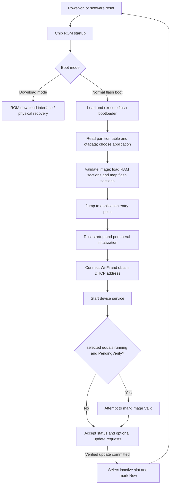

# Device management API: Protobuf over TCP

Current transport update: normal uploads now use gRPC/HTTP2 on TCP 7780,
including optional concurrent logs and explicit Commit/reboot. See the
[current Protolink implementation and validation](../device-management/protolink.md)
and [upload commands](provisioning.md). The legacy wire/harness descriptions below
remain applicable only to the explicit `--legacy` recovery/migration path.

Status: status and unsigned development uploads are implemented. Both the
earlier split-version build and unified version 1 have real ESP32-S3 evidence;
see the testing guide for the exact cases and remaining gaps.
Recovery after actual Wi-Fi loss remains untested.
See [docs/ota/design.md](design.md) for hardware evidence.

This is a custom request/response API using **Protobuf over length-prefixed TCP**,
not gRPC. There is no HTTP/2 transport, gRPC service definition, or gRPC status
code layer. The `.proto` defines messages; our Rust code defines dispatch, session
state, framing, deadlines, and errors. The Mac is the client and the ESP32 is the
server; no separate backend is required.

The diagrams below describe implemented behavior. Authentication, resumable
uploads, and dependable automatic rollback are future work.

The schema is [protocol/ota.proto](../../protocol/ota.proto). Both endpoints use the
shared `ota-protocol` crate, generated with micropb 0.7.0. `protoc` runs on the Mac
at build time; firmware serialization uses fixed-capacity containers, no allocator.

## Status connection and framing

- Mac opens TCP to the explicitly supplied IP; default port **7779**.
- One request and one response per connection; reconnect for another query.
- Each frame is a **four-byte unsigned big-endian body length**, then exactly that
  many Protobuf bytes. The prefix is not part of the Protobuf message.
- Body length must be **1..=512 bytes** in either direction. Reject invalid lengths
  before reading the body. No allocation is based on a peer-supplied length.
- All strings are valid UTF-8 and limited to **64 bytes**, enforced by generated
  fixed-capacity types. The schema alone does not express those bounds; generator
  settings in `crates/ota-protocol/build.rs` are part of the contract.
- Firmware allows one active session with a **180-second total session deadline**
  after accept, including reads, writes and response acknowledgement. Socket
  inactivity and individual request-prefix/body reads are bounded to five seconds.
  Slow partial requests cannot extend the total deadline. Pending handshakes and
  network availability are handled by the underlying stack.
- Mac defaults to a **five-second total deadline**, including connect and I/O;
  `--timeout-ms` can select 1..60000 ms. Host argument parsing accepts IP literals,
  not DNS names, so name resolution cannot escape that deadline.
- After sending and flushing the response, firmware closes the connection. Failed
  or timed-out sessions are aborted; the listener accepts new sessions afterward.
  The CLI retries connection refusals every 50 ms within its original total
  deadline to tolerate the single listener closing/rearming. Once connected, it
  sends only one request; failed requests are never replayed.

## Request and response

`Request` carries `protocol_version = 1`, a `request_id`, and the `status` payload.
A `StatusRequest` message identifies the operation; an absent
payload does not mean status. Its optional `include_timings` boolean requests
device instrumentation; omitted/false means ordinary status. Older firmware
ignores this added field. StatusResponse field 7 optionally carries DeviceTimings,
with request-read, decode, and prepare elapsed microseconds. Absent means
unavailable, not zero. These additive fields preserve v1 interoperability.
Encoding, enqueue, acknowledgement, and close timings are logged over serial
after the response, since they cannot be known before that response is encoded. Response echoes the request ID and reports the
server's protocol version. The current CLI uses ID 1 because each connection has
only one request; the ID is correlation, not authentication or replay protection.

`StatusResponse` fields:

| Field | Meaning |
| --- | --- |
| `device_id` | `esp32s3-` plus the board's base MAC address; descriptive, not authenticated |
| `chip` | `esp32s3` |
| `application` | `device-demo` for the standalone test firmware |
| `firmware_version` | Build-time `FIRMWARE_VERSION`, or package version if unset |
| `uptime_ms` | Milliseconds since the firmware monotonic timer epoch; not wall-clock time |
| `ota_available` | True when the supported layout and an identifiable inactive slot are present |

Ordinary status omits partition inventory; `include_boot` requests it explicitly. Status is
service liveness and build identity, not a sensor-health assertion. Application
identity and version must be nonempty on a successful CLI response.

## Errors and compatibility

- A decoded request with an unsupported protocol version receives
  `UNSUPPORTED_VERSION`, with response protocol version 1 and the echoed ID.
- A decoded v1 request with no supported payload receives `INVALID_REQUEST`.
- Invalid framing, malformed Protobuf, field-capacity violations, disconnects, and
  deadlines close the connection without a response. Correlation may not be
  recoverable, so the server does not fabricate an error ID.
- Protobuf unknown fields follow the decoder's normal skip behavior. An unknown
  operation alone leaves no recognized payload and is rejected. Ordinary Protobuf
  semantics apply to duplicate scalar/oneof fields; do not use re-encoding for
  canonical signature input.
- CLI rejects malformed responses, wrong protocol versions, mismatched request IDs,
  absent supported payloads, and empty identity fields. Errors exit nonzero.
- Additive fields and operations use Protobuf compatibility rules. Increment the
  protocol version only for incompatible framing or behavioral changes. Never
  reuse deleted field numbers when evolving the schema.

## Scope and security

Status v1 is **read-only, unauthenticated plain TCP**, started by the dedicated
`device-demo` firmware. Sensor demos do not start it. It exposes identity and
version to reachable LAN peers. Every `device-demo` build includes the upload
and commit path below, available only with the supported partition layout.
Neither path updates the partition table. Wi-Fi credentials are never
included in status.
Future signed update authorization and optional TLS are covered by
[docs/ota/design.md](design.md).

## Wire example

A status request with request ID 1 encodes as:

```text
00 00 00 06   08 01 10 01 52 00
-----------   -----------------
length = 6    Request protobuf
```

The protocol tests pin this example; host integration tests exercise actual TCP
fragmentation, bad lengths, malformed/truncated bodies, correlation errors,
error responses, deadlines, CLI output, and reconnecting to a mock endpoint.
These do not validate the Embassy TCP implementation on hardware.

## Optional boot inventory

StatusRequest field 2, `include_boot`, requests StatusResponse field 8, `boot`.
Both are additive v1 fields; old firmware ignores the request and omits the reply.
`espctl status --boot` explicitly reports an absent inventory. The inventory is
sampled once on startup, not by performing flash reads on every network request.
It contains configured capacity (from the image header), running/OTA partitions,
partition count, metadata presence, and a read/parse error if unavailable.
Partition labels are limited to 16 bytes, matching ESP partition table storage.
No inventory field establishes bootloader OTA or rollback support. Upload
availability is reported separately through `ota_available`.
The existing 512-byte bound is unchanged; maximal bounded inventory/identity/timing
fields are covered by a control-frame roundtrip test. See `docs/ota/provisioning.md`.

## Unsigned development uploads

All requests use protocol_version 1. Upload dispatch uses the payload operation,
not a separate version number. Status uses one request per connection. Uploads are included in every `device-demo` build.
The device only advertises ota_available when its exact provisioned layout
matches and it can identify a different inactive slot. No signature verification
or TLS is implemented in this milestone.

Upload lifecycle, one TCP connection:

1. BeginUpdate: device-demo, esp32s3, embedded release version (1..31 bytes), exact
   application image length (288 bytes..3 MiB), 32-byte SHA-256.
2. Receiving ack: next_offset 0 and target flash offset.
3. FirmwareChunk: strictly sequential offsets, exactly 4096 bytes except the final
   remainder. Each chunk receives a Receiving ack with the next offset.
4. FinishUpdate: all bytes must have arrived. Hash actual flash contents, validate
   ESP application header/chip/descriptor/capability/version, walk bounded segment
   lengths, verify segment XOR checksum, and verify the ESP SHA-256 image footer.
   Respond Verified only if all checks pass.
5. CommitUpdate: only accepted in Verified state. Change OTA boot selection, mark
   the candidate New, acknowledge best-effort, then software-reset.
6. AbortUpdate: acknowledge Aborted and discard in-memory state without changing
   boot selection. Disconnect or failure also discards state.

The first Begin frame is bounded to the 512-byte control limit. Later upload
frames have a separate 1..4608-byte bound to carry sector-sized Protobuf chunks.
This does not raise the initial/status frame bound. FirmwareChunk.data has a generated 4096-
byte capacity, SHA-256 has capacity 32. Request IDs increment by exactly one per
frame within the session, and responses echo the corresponding ID/version.
Error responses are best effort; invalid framing may simply close the connection.

The first chunk's chip, descriptor/project, version, and OTA capability marker are checked
before the first flash write. Complete verification happens after all writes and
reads flash back; receiving a hash from a sender is not authentication. The target
backend also enforces slot bounds and sector-aligned writes. No transfer can
select the currently running partition as its target.

The device service has a 180-second total session bound and five-second receive
inactivity/per-prefix/per-body deadlines. The host upload has a 180-second total deadline and
bounded I/O waits. Initial connection refusals may be retried; no transmitted
upload operation is automatically retried. Resumable uploads, persistent verified
sessions, automatic fleet rollout, and remote partition-table updates are absent.

Commit can change selection before acknowledgement is delivered. A lost reply is
an uncertain result, not proof of failure. Boot metadata updates and power-loss
behavior still need dedicated fault-injection tests; two slots and image hashes
do not establish automatic rollback from a defective application.


## Operation contract and ownership

All operations use the `Request`/`Response` envelopes in the schema. Responses
carry the matching request ID and protocol version. IDs correlate messages; they
provide neither authentication nor durable transaction identity.

| Request payload | Version / connection | Response | Side effect |
| --- | --- | --- | --- |
| `status` | v1, fresh connection | `StatusResponse` | None; optional boot inventory was captured at startup |
| `begin` | v1, first request | `UploadAck(RECEIVING, next_offset=0)` | Creates volatile transfer state and chooses inactive target; no image write yet |
| `chunk` | v1, same connection | `UploadAck(RECEIVING, next_offset)` | Writes sequential bytes into inactive slot |
| `finish` | v1, same connection | `UploadAck(VERIFIED)` | Reads back and validates entire stored image; selection unchanged |
| `commit` | v1, after verification | Best-effort `UploadAck(COMMITTED)` | Changes boot metadata and resets device |
| `abort` | v1, receiving or verified | `UploadAck(ABORTED)` | Discards transfer state; stored bytes remain, selection unchanged |

`next_offset` is a byte offset relative to the candidate image. `target_offset`
is the absolute flash start of the inactive slot. There is one active connection
and one transfer at a time. Uploads use stop-and-wait: the host waits for each
acknowledgement before sending the next request. An upload session cannot interleave
status queries or begin a second transfer.

Implementation ownership:

- `wifi-network`: radio connection, DHCP, and Embassy network runner.
- `device-service::status`: TCP listener, initial framing, status dispatch and upload handoff.
- `device-service::upload`: upload message ordering, acknowledgements, and reset.
- `ota-core::Update`: metadata, sequential chunk, integrity, and verification rules.
- `device-service::flash_target`: partition bounds, flash I/O, and boot metadata.
- `ota-protocol`: generated micropb messages, capacities, encoding and decoding.
- `espctl`: host-side image validation, upload orchestration, and status reporting.

## Status and upload interactions

```mermaid
sequenceDiagram
    participant CLI as Mac / espctl
    participant Service as ESP32 device service
    participant Flash as Flash / inactive slot
    participant Meta as otadata
    participant Boot as ROM and bootloader
    CLI->>Service: TCP connect, v1 StatusRequest
    Service-->>CLI: StatusResponse (running version, OTA availability)
    Note over CLI,Service: Status connection closes; upload uses a new connection
    CLI->>CLI: Validate application binary and compute SHA-256
    CLI->>Service: BeginUpdate (identity, version, size, digest)
    Service->>Service: Validate metadata and choose inactive slot
    Service-->>CLI: RECEIVING (next_offset=0, target_offset)
    loop Sequential chunks, up to 4096 bytes each
        CLI->>Service: FirmwareChunk (offset, data)
        Service->>Flash: Validate bounds; write sector
        Service-->>CLI: RECEIVING (next_offset)
    end
    CLI->>Service: FinishUpdate
    Service->>Flash: Read back stored image
    Service->>Service: Check digest, descriptor, structure, checksum and footer
    Service-->>CLI: VERIFIED
    alt Default verify-only upload
        CLI->>Service: AbortUpdate
        Service-->>CLI: ABORTED
        Note over Service,Meta: Existing boot selection remains unchanged
    else Explicit --commit
        CLI->>Service: CommitUpdate
        Service->>Meta: Select candidate slot and mark New
        Service-->>CLI: COMMITTED (best effort)
        Service->>Boot: software_reset()
        Boot->>Meta: Read boot selection
        Boot->>Flash: Load/map selected application
        Note over CLI,Boot: After reboot, query status on a fresh connection to check version
    end
```

`COMMITTED` means the metadata update completed in the running application's
view. It does not prove the candidate booted or is healthy. If the reply is lost,
reconnect and inspect running identity/version (and boot inventory); do not replay
commit automatically. Current status has no durable update ID or full selected
metadata query, so an ambiguous or unexpected result may require serial/USB
inspection. A verified transfer cannot be committed after reconnecting: its
verification state was held only in RAM for the original connection.

## Upload session state machine

These are conceptual states in the implemented connection-local workflow, not
persisted enum values. `UploadAck.Phase` reports successful operation results.

```mermaid
stateDiagram-v2
    [*] --> AwaitBegin: TCP accepted
    AwaitBegin --> Receiving: Valid Begin / RECEIVING
    Receiving --> Receiving: Valid sequential Chunk / RECEIVING
    Receiving --> Verified: Finish with all bytes and valid image / VERIFIED
    Verified --> Committing: Commit
    Committing --> Resetting: Boot metadata updated; best-effort COMMITTED
    Resetting --> [*]: Software reset
    Receiving --> Aborted: Abort / ABORTED
    Verified --> Aborted: Abort / ABORTED
    AwaitBegin --> Closed: Invalid request or I/O failure
    Receiving --> Closed: Invalid operation, validation failure, disconnect or deadline
    Verified --> Closed: Invalid operation, disconnect or deadline
    Committing --> Closed: Storage error; inspect metadata before retry
    Aborted --> [*]: Close connection
    Closed --> [*]: Discard volatile session state
```

Before commit starts, abort/error/disconnect leaves boot selection unchanged;
it does not erase the partially or completely written inactive slot. Once commit
starts, a storage failure or power loss may leave metadata partially changed;
recovery behavior still needs fault-injection testing. Sending another chunk or
Finish after verification is invalid. Finish before all bytes arrive and Commit
before successful verification are invalid. Errors terminate the session rather
than allowing corrections within it.

## Boot and application lifecycle



Our application uses an ESP-IDF-compatible bootloader format through Rust crates;
it does not call the ESP-IDF OTA C runtime. `FlashStorage` writes the image,
`Ota` edits the `otadata` records, and `software_reset()` transfers control back
to chip startup. The bootloader, not the `Ota` object, starts the chosen image.

The current confirmation hook runs after networking is initialized, attempts to
mark a matching `PendingVerify` image `Valid`, and logs confirmation errors while continuing to serve requests.
It is not a complete health policy. Rollback support in the installed bootloader,
a bounded health deadline, and reset/power-loss recovery are not yet verified.
The diagrams do not claim automatic fallback works today.


## Versioning decision

Status and upload share protocol version 1. Protobuf field numbers and unknown
field handling support additive schema evolution; protocol_version rejects
incompatible framing or semantics, not individual capabilities. Upload capability
is advertised through ota_available and requires the supported partition layout.

The earlier development-only status-v1/upload-v2 split is superseded. The
capability marker `rust-dev-ota-v1` rejects incompatible old images. See
[validation status](testing.md#validation-status) for the current build.

## LAN discovery and management state

Discovery uses standard mDNS/DNS-SD records. StatusResponse field 9 adds a
bounded management-state string; older firmware omits it. See [service discovery](../device-management/discovery.md) for PTR/SRV/A/
TXT records and cache semantics. TCP framing/version are unchanged.
